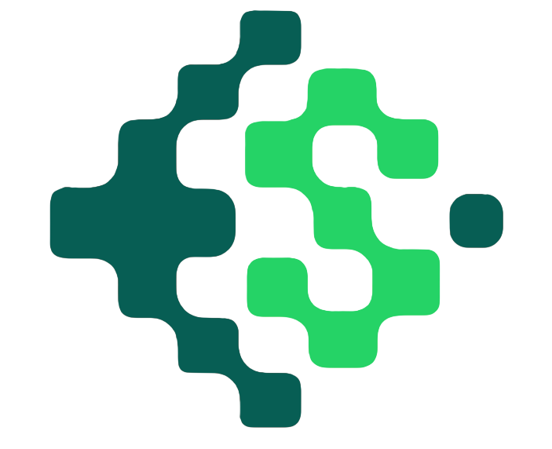

<p align="center">
  
</p>

<h1 align="center">Stego.Image</h1>

<p align="center">
  Hide any file inside an image — encrypted, compressed, and invisible to the human eye.<br/>
  100% client-side. No servers. No uploads. Your data never leaves your device.
</p>

<p align="center">
  
  
  
  
</p>

<p align="center">
  <a href="README.md"> <strong>Bahasa Indonesia</strong></a> | <a href="README.en.md"> <strong>English Version</strong></a>
</p>

---

## About

Stego.Image is a secure, client-side steganography tool that hides any file
inside a PNG image using AES-256 encryption and DEFLATE compression. All
operations run entirely in your browser — no data ever touches a server.

---

## How It Works
```
File → DEFLATE compress → AES-256 encrypt → LSB embed into pixels → PNG output
```

**LSB (Least Significant Bit) steganography** modifies only the last bit of
each RGB channel per pixel — a change invisible to the human eye, but enough
to encode binary data across millions of pixels.

```
Original:  1 1 0 0 1 0 1 [0]  =  202
Modified:  1 1 0 0 1 0 1 [1]  =  203  ← visually identical
```

Two independent security layers:
- **Steganography** — hides the *existence* of the data
- **Encryption** — protects the *content* if the data is ever detected

---

## Features

- **AES-256 Encryption** — PBKDF2-SHA256 key derivation at 100,000 iterations with a random salt
- **DEFLATE Compression** — shrinks the payload before embedding to maximise image capacity
- **LSB Steganography** — pixel-level data hiding using the HTML5 Canvas API
- **Any File Type** — PDF, ZIP, images, video, code, documents
- **Capacity Indicator** — shows available space before encoding
- **ZIP Export** — download all decoded files in a single archive

---

## Security

| Layer | Technology | Protects Against |
|---|---|---|
| Steganography | LSB pixel embedding | Casual detection — hidden file is invisible |
| Encryption | AES-256 + PBKDF2-SHA256 | Content exposure — unreadable without the password |

Both layers must be defeated independently. Even if hidden data is detected
and extracted, AES-256 makes it unreadable without the correct password.

> **Privacy:** All cryptographic operations use `crypto-js` and run entirely
> in your browser. No key material, plaintext, or file content is ever transmitted.

---

## Tech Stack

| Category | Technology |
|---|---|
| Framework | React 19 + Vite |
| Styling | Bootstrap 5 |
| Encryption | crypto-js (AES-256, PBKDF2-SHA256) |
| Compression | pako (DEFLATE) |
| File handling | file-saver, jszip |
| File upload | react-dropzone |
| Routing | react-router-dom |
| Hosting | Cloudflare Pages |

---

## Contributing

Contributions are welcome. Please read
[CONTRIBUTING.md](CONTRIBUTING.md) for development setup and guidelines.

---

## License

MIT License. See [LICENSE](LICENSE) for details.
