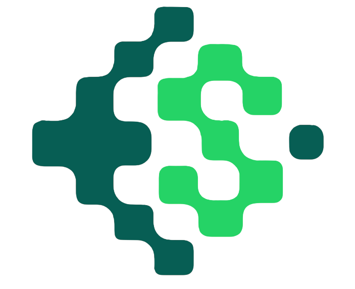

<p align="center">
  
</p>

<h1 align="center">Stego.Image</h1>

<p align="center">
  <strong>Sembunyikan Berkas Apapun di Dalam Gambar — Terenkripsi, Terkompresi, dan Kasatmata bagi Mata Manusia.</strong><br/>
  100% Client-Side. Tanpa Server. Tanpa Unggah Data. Privasi Mutlak di Browser Anda.
</p>

<p align="center">
  
  
  
  
  
</p>

<p align="center">
  <a href="README.md"> <strong>Bahasa Indonesia</strong></a> | <a href="README.en.md"> <strong>English Version</strong></a>
</p>

---

## 📑 Daftar Isi

- [Tentang Stego.Image](#-tentang-stegoimage)
- [Arsitektur & Filosofi Zero-Knowledge](#-arsitektur--filosofi-zero-knowledge)
- [Alur Kerja Sistem (Pipeline Architecture)](#-alur-kerja-sistem-pipeline-architecture)
  - [Pipeline Encoding (Penyisipan)](#1-pipeline-encoding-penyisipan)
  - [Pipeline Decoding (Ekstraksi)](#2-pipeline-decoding-ekstraksi)
- [Spesifikasi Format Biner (Binary Wire Format)](#-spesifikasi-format-biner-binary-wire-format)
  - [Layout Stream Biner](#layout-stream-biner)
  - [Rincian Struktur Blok Plaintext](#rincian-struktur-blok-plaintext)
- [Mekanisme Inti & Komponen Teknis](#-mekanisme-inti--komponen-teknis)
  - [1. Kompresi DEFLATE (Pre-Encryption)](#1-kompresi-deflate-pre-encryption)
  - [2. Enkripsi AES-256 & Derivasi Kunci PBKDF2](#2-enkripsi-aes-256--derivasi-kunci-pbkdf2)
  - [3. Steganografi LSB (Least Significant Bit)](#3-steganografi-lsb-least-significant-bit)
  - [4. Isolasi Piksel Opak & Filter Alfa](#4-isolasi-piksel-opak--filter-alfa)
  - [5. Rumus Kapasitas Gambar](#5-rumus-kapasitas-gambar)
- [Temuan Analisis Mendalam (Reverse Engineering Insights)](#-temuan-analisis-mendalam-reverse-engineering-insights)
  - [Pencegahan Kerusakan Data Akibat Kompresi Lossy Media Sosial](#pencegahan-kerusakan-data-akibat-kompresi-lossy-media-sosial)
  - [Analisis Perilaku Toggle Enkripsi Antarmuka vs Engine](#analisis-perilaku-toggle-enkripsi-antarmuka-vs-engine)
  - [Integritas Rendering Kanvas Tanpa Anti-Aliasing](#integritas-rendering-kanvas-tanpa-anti-aliasing)
- [Struktur Proyek](#-struktur-proyek)
- [Panduan Penggunaan](#-panduan-penggunaan)
  - [Menyembunyikan Berkas (Encode)](#cara-menyembunyikan-berkas-encode)
  - [Mengekstraksi Berkas (Decode)](#cara-mengekstraksi-berkas-decode)
- [Panduan Instalasi & Pengembangan Lokal](#-panduan-instalasi--pengembangan-lokal)
- [Modul Pembelajaran (Knowledge Base)](#-modul-pembelajaran-knowledge-base)
- [Kontribusi & Lisensi](#-kontribusi--lisensi)

---

## 💡 Tentang Stego.Image

**Stego.Image** adalah aplikasi web steganografi modern tingkat lanjut yang memungkinkan pengguna menyembunyikan berkas digital jenis apapun (dokumen teks, PDF, arsip ZIP, rekaman suara, video, hingga kode sumber) ke dalam citra PNG tanpa menimbulkan perubahan visual yang dapat dideteksi oleh mata telanjang.

Aplikasi ini menggabungkan dua pilar keamanan independen (*Defense in Depth*):
1. **Steganografi (Security through Obscurity):** Menyembunyikan *keberadaan* data rahasia di dalam derau piksel gambar pembawa (*carrier/cover image*).
2. **Kriptografi (Mathematical Confidentiality):** Mengamankan *isi* data menggunakan enkripsi simetris standar militer **AES-256-CBC** yang diperkuat derivasi kunci **PBKDF2-SHA256 (100.000 iterasi)**. Sekalipun data diekstrak secara analitis (misal melalui *chi-square attack* atau ekstraksi bit mentah), data tetap berwujud *ciphertext* acak yang tidak mungkin dibaca tanpa kata sandi yang valid.

---

## 🛡️ Arsitektur & Filosofi Zero-Knowledge

Stego.Image dibangun dengan prinsip privasi mutlak:

```
[Perangkat Pengguna] ──── (100% Client-Side Web APIs) ────> [Output PNG / File Asli]
         │
         ✕  TIDAK ADA DATA YANG DIKIRIM KE INTERNET
         ▼
[Server / Cloudflare] ─── Hanya Menyajikan Aset Statis (HTML/JS/CSS)
```

- **Tanpa Backend / Tanpa API:** Seluruh pemrosesan citra, kompresi zlib, derivasi kunci, dan manipulasi bit dilakukan secara lokal di lingkungan runtime JavaScript peramban (*client-side*).
- **Web APIs Standar:** Memanfaatkan HTML5 Canvas 2D API (`getImageData`, `putImageData`), TypedArrays (`Uint8Array`, `ArrayBuffer`), `TextEncoder`/`TextDecoder`, dan Object URLs.
- **Plausible Deniability:** Tidak ada metadata dalam bentuk teks biasa (*plaintext*) yang disematkan ke dalam gambar. Seluruh metadata (nama berkas, MIME type, ukuran) turut dienkripsi ke dalam satu blok terpadu bersama payload berkas. Gambar stego tampak identik dengan gambar normal secara visual maupun metadata EXIF/PNG.

---

## 🔄 Alur Kerja Sistem (Pipeline Architecture)

### 1. Pipeline Encoding (Penyisipan)

Tahapan transformasi berkas rahasia menjadi gambar stego secara berurutan pada `src/utils/stego.js`:

1. **Pembacaan Buffer Berkas:** Berkas rahasia dibaca dari antarmuka peramban sebagai `ArrayBuffer`, lalu dikonversi menjadi representasi biner `Uint8Array`.
2. **Kompresi Data (Pre-Encryption):** Payload biner dipadatkan menggunakan algoritma **DEFLATE** via pustaka `pako` (`src/utils/compression.js`) guna menghemat kapasitas piksel sebelum entropi dinaikkan oleh enkripsi.
3. **Penyusunan Blok Plaintext Terpadu:** Header dan metadata digabungkan bersama data terkompresi ke dalam satu array byte:
   - **Magic Signature:** `0x53, 0x54, 0x47, 0x4F` (`"STGO"`).
   - **Metadata Nama Berkas:** 4 byte panjang string nama + string nama ber-encoding UTF-8.
   - **Metadata MIME Type:** 4 byte panjang string tipe + string MIME type ber-encoding UTF-8.
   - **Ukuran Asli:** 4 byte `uint32` ukuran berkas asli sebelum kompresi.
   - **Payload:** Byte data berkas hasil kompresi DEFLATE.
4. **Pembangkitan Salt Kriptografis:** Dibuat salt acak 16-byte kriptografis (`CryptoJS.lib.WordArray.random(16)`).
5. **Derivasi Kunci Kriptografi:** Kunci rahasia 256-bit diturunkan dari kata sandi dan salt menggunakan **PBKDF2-SHA256 (100.000 iterasi)** (`src/utils/encryption.js`).
6. **Enkripsi AES-256-CBC:** Seluruh blok plaintext dienkripsi menggunakan AES-256 dengan IV berbasis salt, menghasilkan string ciphertext Base64.
7. **Pembungkusan Stream Terenkripsi (*Envelope Packaging*):** Blok ciphertext digabungkan dengan salt 16-byte, lalu diawali dengan 4 byte `uint32` yang menyatakan total ukuran payload terenkripsi.
8. **Konversi ke Aliran Bit (*Bit Serialization*):** Setiap byte dari stream diubah menjadi 8 bit individual dengan urutan *Most Significant Bit* (MSB) ke *Least Significant Bit* (LSB).
9. **Ekstraksi Piksel Gambar Cover:** Kanvas HTML5 me-render gambar cover dan mengekstrak array piksel mentah via `ctx.getImageData`.
10. **Validasi Kapasitas Piksel:** Sistem menghitung piksel opak (`alpha === 255`) dan memverifikasi bahwa total bit payload tidak melebihi kapasitas citra ($\text{opaquePixels} \times 3$).
11. **Penyisipan Bit Spasial (LSB Insertion):** Setiap bit disuntikkan secara berurutan ke bit ke-0 saluran warna Merah (R), Hijau (G), dan Biru (B) dari setiap piksel opak (`pixels[i + j] = (pixels[i + j] & 254) | bit`).
12. **Rasterisasi & Ekspor:** Piksel hasil modifikasi ditulis kembali ke kanvas (`ctx.putImageData`) dan diekspor menjadi Data URL berformat PNG tanpa kompresi lossy (`canvas.toDataURL("image/png")`). Pengguna dapat memilih unduh langsung sebagai PNG atau dikemas ke dalam ZIP via `src/utils/downloadZip.js`.

### 2. Pipeline Decoding (Ekstraksi)

Tahapan pemulihan berkas rahasia dari citra stego secara berurutan pada `src/utils/decode.js`:

1. **Rendering Citra Tanpa Interpolasi:** Citra stego dimuat ke elemen kanvas off-screen dengan properti `ctx.imageSmoothingEnabled = false` untuk mencegah perataan piksel.
2. **Ekstraksi Array Piksel:** Seluruh data warna dan alfa diekstraksi ke dalam memori peramban menggunakan `ctx.getImageData`.
3. **Pengambilan Bit LSB:** Sistem memindai seluruh piksel opak (`alpha === 255`), lalu membaca bit ke-0 dari saluran R, G, dan B (`pixel & 1`) untuk dikumpulkan ke dalam array bit.
4. **Rekonstruksi Byte Stream:** Setiap kelompok 8 bit direkonstruksi kembali menjadi byte utuh (MSB ke LSB) untuk membentuk array biner `Uint8Array`.
5. **Pembacaan Ukuran Terenkripsi:** 4 byte pertama dibaca sebagai `uint32` Big-Endian untuk menentukan panjang persis data ciphertext yang harus diproses.
6. **Pemisahan Salt & Ciphertext:** 16 byte pertama dari payload diambil sebagai salt kriptografis, sedangkan sisa byte didekodekan sebagai string Base64 ciphertext.
7. **Derivasi Ulang Kunci:** Kunci AES-256 direkonstruksi menggunakan kata sandi yang dimasukkan pengguna bersama salt yang diekstrak melalui PBKDF2-SHA256 (100.000 iterasi).
8. **Dekripsi AES-256-CBC:** Data Base64 didekripsi. Jika kata sandi salah atau data rusak, proses akan gagal pada tahap ini.
9. **Verifikasi Magic Bytes ("STGO"):** Sistem memeriksa 4 byte pertama dari blok plaintext yang berhasil didekripsi. Jika byte tidak persis bernilai `0x53, 0x54, 0x47, 0x4F`, sistem langsung menolak dan melempar galat (*wrong password / corrupted data*).
10. **Penguraian Metadata:**
    - Membaca 4 byte panjang nama berkas, lalu men-decode nama berkas asli via `TextDecoder` (UTF-8).
    - Membaca 4 byte panjang tipe MIME, lalu men-decode string MIME type asli (UTF-8).
    - Membaca 4 byte ukuran berkas asli sebelum dikompresi.
11. **Dekompresi DEFLATE:** Sisa byte payload didekompresi menggunakan `pako.inflate` (`src/utils/compression.js`) guna mengembalikan berkas ke bentuk biner aslinya.
12. **Validasi Ukuran Akhir:** Ukuran biner hasil dekompresi dicocokkan dengan metadata ukuran asli yang tercatat untuk menjamin integritas 100%.
13. **Pembuatan Objek Unduhan:** Data biner dibungkus ke dalam objek `Blob` dengan tipe MIME aslinya, lalu URL objek dibuat agar berkas siap diunduh oleh pengguna.

---

## 📦 Spesifikasi Format Biner (Binary Wire Format)

Stego.Image menerapkan tata letak biner yang ringkas dan aman. Setiap integer biner menggunakan format **32-bit unsigned integer (uint32) Big-Endian**.

### Layout Stream Biner

Data yang disuntikkan ke dalam LSB piksel gambar terbagi menjadi dua lapisan:

```
┌────────────────────────────────────────────────────────────────────────────────────────┐
│                               OUTER BITSTREAM WRAPPER                                  │
├─────────────────────────┬──────────────────────────────────────────────────────────────┤
│ Offset (Byte)           │ Keterangan                                                   │
├─────────────────────────┼──────────────────────────────────────────────────────────────┤
│ 0x00 .. 0x03 (4 Byte)   │ Encrypted Payload Length (uint32, Big-Endian)                │
│ 0x04 .. 0x13 (16 Byte)  │ Cryptographic Salt PBKDF2 (16 bytes random)                  │
│ 0x14 .. End             │ Ciphertext AES-256 (Base64 string di-encode ke UTF-8 bytes)  │
└─────────────────────────┴──────────────────────────────────────────────────────────────┘
```

### Rincian Struktur Blok Plaintext

Sebelum dienkripsi, berkas dan seluruh metadatanya digabungkan menjadi satu blok byte tunggal (`plaintext`):

```
┌────────┬──────────────────────┬─────────────┬──────────────────────┬─────────────┬──────────────┬─────────────────────┐
│ 4 Byte │ 4 Byte               │ N Byte      │ 4 Byte               │ M Byte      │ 4 Byte       │ Sisa Byte           │
├────────┼──────────────────────┼─────────────┼──────────────────────┼─────────────┼──────────────┼─────────────────────┤
│ "STGO" │ Filename Length (N)  │ Filename    │ MimeType Length (M)  │ MimeType    │ Size Asli    │ Payload Terkompresi │
│ Magic  │ (uint32 Big-Endian)  │ (UTF-8)     │ (uint32 Big-Endian)  │ (UTF-8)     │ (uint32 BE)  │ (DEFLATE / zlib)    │
└────────┴──────────────────────┴─────────────┴──────────────────────┴─────────────┴──────────────┴─────────────────────┘
```

1. **Magic Signature (`0x53 0x54 0x47 0x4F` / `"STGO"`):** Pengidentifikasi unik aplikasi. Berada di dalam blok terenkripsi sehingga berfungsi ganda sebagai *tamper & wrong-password detector*. Jika kata sandi salah, dekripsi menghasilkan byte acak sehingga perbandingan 4 byte pertama ini langsung memicu error yang aman.
2. **Filename Field:** Panjang string nama berkas (4 byte) diikuti byte karakter UTF-8 nama berkas (misal: `dokumen_rahasia.pdf`).
3. **MIME Type Field:** Panjang string MIME (4 byte) diikuti byte tipe media (misal: `application/pdf` atau `image/png`).
4. **Original Size:** Ukuran berkas mentah sebelum dikompresi (4 byte uint32). Digunakan pada tahap akhir untuk memverifikasi integritas dekompresi.
5. **Compressed Payload:** Data biner berkas yang telah dipadatkan menggunakan algoritma DEFLATE.

---

## 🔬 Mekanisme Inti & Komponen Teknis

### 1. Kompresi DEFLATE (Pre-Encryption)
- **Implementasi:** Pustaka `pako` (`pako.deflate` & `pako.inflate`).
- **Prinsip Entropi Informasi Shannon:** Data yang telah dienkripsi secara kriptografis memiliki entropi maksimal (distribusi bit mendekati acak murni seragam / *pseudo-random*). Data acak secara matematis **mustahil dikompresi**. Oleh karena itu, Stego.Image selalu menjalankan kompresi DEFLATE **sebelum** proses enkripsi.
- **Dampak Praktis:** Menghemat ruang kapasitas piksel gambar hingga 20% - 80% (terutama untuk dokumen teks, berkas kode sumber, PDF, atau format dokumen terstruktur).

### 2. Enkripsi AES-256 & Derivasi Kunci PBKDF2
- **Algoritma:** AES-256 dalam mode Cipher Block Chaining (CBC) dengan bantalan PKCS#7 via `crypto-js`.
- **Derivasi Kunci (KDF):** PBKDF2 (*Password-Based Key Derivation Function 2*) menggunakan algoritma hash internal HMAC-SHA256.
- **Parameter KDF:**
  - Panjang Kunci: 256 bit (32 byte / 8 words).
  - Iterasi: **100.000 putaran** (memberikan resistensi signifikan terhadap serangan *brute-force* berbasis GPU).
  - Salt: **16 byte acak kriptografis** (`CryptoJS.lib.WordArray.random(16)`) yang dibuat baru pada setiap sesi encoding, mencegah serangan *Rainbow Table*.
  - Initialization Vector (IV): Menggunakan salt 16-byte untuk memastikan keacakan blok ciphertext pertama.

### 3. Steganografi LSB (Least Significant Bit)
Steganografi spasial LSB beroperasi dengan mengganti bit paling tidak signifikan (bit ke-0) pada saluran warna RGB dengan bit data rahasia.

Contoh modifikasi nilai intensitas kanal warna 8-bit (0–255):
```
Nilai Byte Asli : 202 (Biner: 11001010) -> Bit terakhir = 0
Bit Data Rahasia :   1
Nilai Byte Stego: 203 (Biner: 11001011) -> Bit terakhir = 1
Perubahan visual: +1 dari 256 level intensitas (0.39%), tidak kasatmata bagi mata manusia.
```

Operasi bitwise pada kode (`src/utils/stego.js`):
```javascript
// Menghapus LSB dengan bitwise AND 254 (0xFE), lalu menyuntikkan bit rahasia
pixels[i + j] = (pixels[i + j] & 254) | bits[bitIndex++];
```

### 4. Isolasi Piksel Opak & Filter Alfa
Kanvas gambar HTML5 menyajikan data piksel dalam format array satu dimensi `Uint8ClampedArray` dengan urutan `[R, G, B, A, R, G, B, A, ...]`.
- Stego.Image **hanya** menggunakan piksel yang memiliki nilai transparansi penuh:
  ```javascript
  if (pixels[i + 3] === 255) { /* gunakan saluran R, G, B */ }
  ```
- **Alasan Teknis:**
  1. Menghindari distorsi pada piksel semi-transparan yang dapat merusak gradasi visual atau tepi (*edges*) gambar PNG.
  2. Kanal alfa (`pixels[i + 3]`) **tidak pernah dimodifikasi**, menjaga konsistensi transparansi gambar asli.

### 5. Rumus Kapasitas Gambar
Kapasitas data maksimum yang dapat ditampung sebuah citra dihitung berdasarkan jumlah piksel opak:

$$\text{Kapasitas (Byte)} = \left\lfloor \frac{N_{\text{opak}} \times 3}{8} \right\rfloor$$

*Di mana:*
- $N_{\text{opak}}$: Jumlah piksel dengan nilai saluran Alpha $\text{A} = 255$.
- Setiap piksel opak menyumbang 3 bit (1 bit dari Red, 1 bit dari Green, 1 bit dari Blue).
- Dibagi 8 untuk mengonversi total bit ke byte.

*Contoh Perhitungan:*
Sebuah gambar cover beresolusi Full HD ($1920 \times 1080$) tanpa transparansi memiliki $2.073.600$ piksel opak:
$$\text{Kapasitas} = \frac{2.073.600 \times 3}{8} = 777.600 \text{ Byte} \approx 759,37 \text{ KB}$$

---

## 🔍 Temuan Analisis Mendalam (Reverse Engineering Insights)

Berdasarkan audit teknis mendalam terhadap kode sumber dan arsitektur aplikasi:

### Pencegahan Kerusakan Data Akibat Kompresi Lossy Media Sosial
- **Anatomi Masalah:** Algoritma LSB sangat rentan terhadap kompresi *lossy* (seperti konversi ke JPEG, kompresi ulang WebP, atau subsampling kroma yang diterapkan secara otomatis oleh platform pengirim pesan seperti WhatsApp, Telegram non-file, Instagram, dan Twitter/X). Kompresi tersebut mengubah nilai piksel individual, sehingga bit LSB rusak secara permanen dan berkas rahasia tidak dapat didekripsi.
- **Solusi Rekayasa:** Pengembang mengintegrasikan pustaka `JSZip` dan `file-saver` (`src/utils/downloadZip.js`) untuk menyediakan opsi **"Download ZIP (Safe Share)"**. Saat gambar PNG dibungkus ke dalam format `.zip`, platform media sosial mengenali berkas sebagai arsip dokumen biner mentah dan tidak melakukan kompresi ulang terhadap citra di dalamnya.

### Analisis Perilaku Toggle Enkripsi Antarmuka vs Engine
- **Observasi Kode:**
  - Pada komponen UI (`src/pages/Encode.jsx` & `src/pages/Decode.jsx`), terdapat tombol beralih (*toggle*) enkripsi ON/OFF.
  - Namun, pada level modul inti (`src/utils/stego.js` & `src/utils/decode.js`), fungsi `encodeImage` memanggil `encryptData(plaintext, password)` secara langsung, dan fungsi `decodeImage` memiliki penjaga ketat:
    ```javascript
    if (!password) {
      throw new Error("Password is required to decode this image.");
    }
    ```
- **Catatan Teknis bagi Pengembang:** Engine steganografi dirancang dengan praduga bahwa *enkripsi selalu wajib diaktifkan*. Jika toggle dimatikan di antarmuka, nilai `null` diteruskan dan dapat menyebabkan kegagalan dekripsi pada berkas tanpa kata sandi. Sangat disarankan untuk **selalu mengaktifkan enkripsi dan menyetel kata sandi** demi keamanan optimal dan kompatibilitas decoding.

### Integritas Rendering Kanvas Tanpa Anti-Aliasing
- Pada proses decoding di `src/utils/decode.js`, kanvas secara eksplisit menyetel:
  ```javascript
  ctx.imageSmoothingEnabled = false;
  ```
- **Fungsi Kritis:** Pengaturan ini memastikan peramban tidak menerapkan interpolasi bilinear/bicubic saat memuat citra ke konteks 2D kanvas, menjaga ketepatan setiap bit LSB pada nilai heksadesimal warna asli.

---

## 📂 Struktur Proyek

```plaintext
Stego.Image/
├── public/                       # Aset publik statis
│   ├── logo.png                  # Logo utama aplikasi
│   ├── OG-image.png              # Banner Open Graph media sosial
│   ├── robots.txt                # Konfigurasi perayap web
│   ├── sitemap.xml               # Peta situs untuk optimasi SEO
│   └── _redirects                # Konfigurasi routing Cloudflare Pages SPA
├── src/
│   ├── assets/                   # Aset internal modul
│   ├── components/               # Komponen antarmuka yang dapat digunakan ulang
│   │   ├── Navbar.jsx            # Bilah navigasi responsif
│   │   └── Footer.jsx            # Footer bergaya GitHub dengan versi dinamis
│   ├── pages/                    # Halaman utama aplikasi
│   │   ├── Home.jsx              # Landing page informatif & interaktif
│   │   ├── Encode.jsx            # Ruang kerja penyisipan data ke gambar
│   │   ├── Decode.jsx            # Ruang kerja ekstraksi & dekripsi data
│   │   ├── About.jsx             # Halaman filosofi & arsitektur proyek
│   │   └── learn/                # 7 Modul panduan & edukasi steganografi
│   │       ├── HowSteganographyWorks.jsx
│   │       ├── LsbSteganography.jsx
│   │       ├── ImageSteganography.jsx
│   │       ├── Aes256Encryption.jsx
│   │       ├── SteganographyVsEncryption.jsx
│   │       ├── DetectHiddenData.jsx
│   │       └── UseCases.jsx
│   ├── utils/                    # Utilitas logika inti & kriptografi
│   │   ├── compression.js        # Utilitas DEFLATE/inflate via pako
│   │   ├── decode.js             # Parser biner & ekstraktor LSB
│   │   ├── downloadZip.js        # Utilitas pembungkus arsip ZIP via JSZip
│   │   ├── encryption.js         # Engine AES-256 & PBKDF2 via crypto-js
│   │   └── stego.js              # Engine injeksi LSB piksel kanvas
│   ├── App.jsx                   # Konfigurasi rute & React Error Boundary
│   ├── App.css                   # Gaya khusus aplikasi & palet warna gelap
│   ├── index.css                 # Gaya global & reset Bootstrap
│   └── main.jsx                  # Titik masuk utama React 19
├── index.html                    # Kerangka HTML5 & metadata JSON-LD SEO
├── package.json                  # Definisi dependensi & skrip npm
├── vite.config.js                # Konfigurasi build bundler Vite
└── CHANGELOG.md                  # Riwayat pembaruan & rilis versi
```

---

## 🚀 Panduan Penggunaan

### Cara Menyembunyikan Berkas (Encode)
1. Buka menu **Encode** pada navigasi atas.
2. Unggah **Cover Image** (disarankan berformat **PNG** atau **BMP** tanpa kompresi).
3. Periksa panel **Estimated Image Capacity** untuk memastikan kapasitas citra mencukupi.
4. Unggah **Secret File** yang ingin Anda sembunyikan.
5. Masukkan **Encryption Password** yang kuat.
6. Klik tombol **Execute Encoding**.
7. Setelah proses selesai:
   - Pilih **Download PNG** jika ingin menyimpan gambar langsung di perangkat lokal.
   - Pilih **Download ZIP (Safe Share)** jika Anda berencana mengirimkan gambar melalui platform pesan instan (WhatsApp, Telegram, Discord, dsb.) agar integritas LSB tidak rusak oleh kompresi otomatis platform.

### Cara Mengekstraksi Berkas (Decode)
1. Buka menu **Decode** pada navigasi atas.
2. Unggah **Stego Image** (berkas PNG yang memuat data tersembunyi).
3. Masukkan **Decryption Password** yang sama persis dengan yang dimasukkan saat proses encoding.
4. Klik tombol **Execute Decoding**.
5. Berkas asli akan dipulihkan secara otomatis beserta nama dan format aslinya, lalu siap diunduh ke komputer Anda.

> [!TIP]
> **Kriteria Gambar Cover yang Baik:**
> Pilihlah gambar dengan resolusi tinggi yang memiliki banyak variasi warna, tekstur kompleks, atau detail halus (misalnya pemandangan alam, kerumunan dedaunan, atau foto perkotaan). Gambar dengan area warna solid yang luas (seperti warna putih atau hitam polos) lebih rentan terhadap analisis visual histogram (*visual attack*).

---

## 🛠️ Panduan Instalasi & Pengembangan Lokal

Pastikan Anda telah memasang **Node.js** (versi 18 ke atas) dan **npm** di sistem Anda.

```bash
# 1. Kloning repositori ini
git clone https://github.com/50RISHU/Stego.Image.git
cd Stego.Image

# 2. Pasang semua dependensi
npm install

# 3. Jalankan server pengembangan lokal (Vite)
npm run dev

# 4. Bangun versi produksi (Production Build)
npm run build

# 5. Jalankan pratinjau build produksi secara lokal
npm run preview

# 6. Jalankan linter kode (ESLint)
npm run lint
```

Aplikasi pengembangan akan berjalan secara default di `http://localhost:5173`.

---

## 📚 Modul Pembelajaran (Knowledge Base)

Stego.Image tidak hanya berfungsi sebagai alat utilitas, tetapi juga sebagai platform edukasi keamanan siber komprehensif yang memuat 7 modul panduan interaktif:

| Modul Pembelajaran | Topik Bahasan Utama |
|---|---|
| **How Steganography Works** | Sejarah steganografi klasik (tinta kasatmata, lilin skytale) hingga era digital modern. |
| **LSB Steganography** | Penjelasan mendalam mengenai manipulasi bit ke-0 pada saluran piksel RGB 8-bit. |
| **Image Steganography** | Perbedaan perilaku format citra (PNG lossless vs JPEG/WebP lossy) terhadap data LSB. |
| **AES-256 Encryption** | Prinsip kerja enkripsi simetris, blok chiper, peran salt, dan derivasi kunci PBKDF2. |
| **Steganography vs Encryption** | Analisis komparatif: menyembunyikan eksistensi data vs melindungi kerahasiaan isi data. |
| **Detect Hidden Data** | Metode steganalisis statistik (uji Chi-Square, analisis histogram spasial, dan Sample Pair Analysis). |
| **Use Cases** | Penerimaan praktis: perlindungan jurnalis di wilayah represif, watermarking digital, dan transmisi kredensial aman. |

---

## 🤝 Kontribusi & Lisensi

Kontribusi dari komunitas sangat diapresiasi! Untuk berkontribusi:
1. *Fork* repositori ini.
2. Buat *branch* fitur baru Anda (`git checkout -b fitur/fitur-keren`).
3. Lakukan *commit* terhadap perubahan Anda (`git commit -m 'feat: menambahkan fitur keren'`).
4. *Push* ke *branch* Anda (`git push origin fitur/fitur-keren`).
5. Buat sebuah *Pull Request* baru.

Silakan pelajari [CONTRIBUTING.md](CONTRIBUTING.md) untuk panduan kontribusi yang lebih rinci.

### Lisensi
Proyek ini dilisensikan di bawah naungan **Lisensi MIT**. Lihat berkas [LICENSE](LICENSE) untuk informasi hak cipta dan ketentuan penggunaan secara lengkap.
